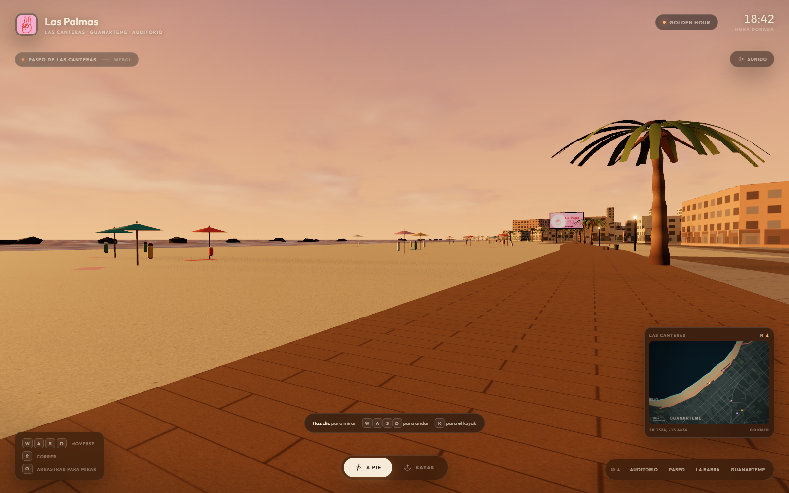
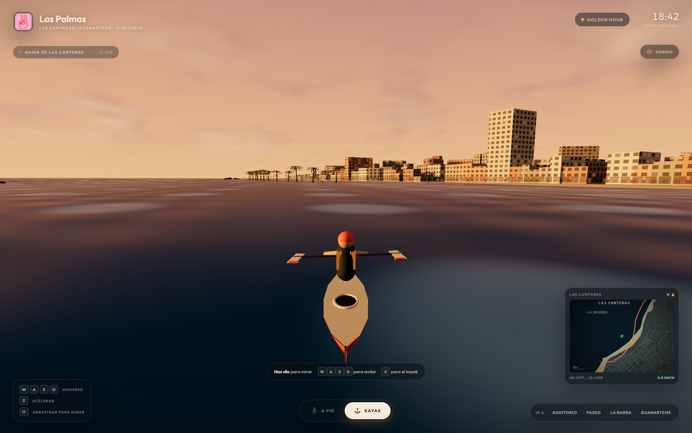
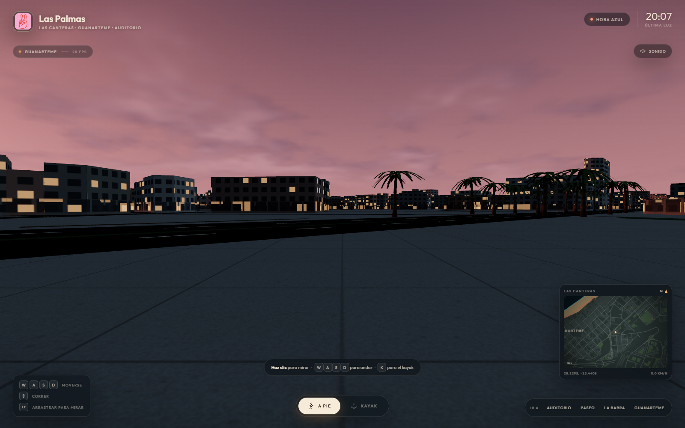

# Las Palmas · Golden Hour

Una experiencia inmersiva en 3D de **Las Palmas de Gran Canaria**, centrada en la playa de Las Canteras, Guanarteme y el Auditorio Alfredo Kraus. Construida con **Three.js**, **Vite** y datos reales de **OpenStreetMap**.



## Arrancar

```bash
npm install
npm run dev
```

Abre `http://localhost:5173`. Para una build de producción:

```bash
npm run build
npm run preview
```

Requiere Node.js 20.19+ o 22.12+ (recomendado Node 22 LTS).

## Publicar en GitHub Pages

El proyecto ya está preparado para GitHub Pages: la build usa rutas relativas y el workflow está en [.github/workflows/pages.yml](.github/workflows/pages.yml).

1. Crea un repositorio en GitHub y sube el proyecto:

```bash
git init
git add .
git commit -m "Las Palmas · Golden Hour"
git branch -M main
git remote add origin https://github.com/TU-USUARIO/TU-REPO.git
git push -u origin main
```

2. En el repositorio entra en **Settings → Pages → Build and deployment** y elige **GitHub Actions** como fuente.
3. El workflow `Deploy a GitHub Pages` se ejecuta en cada push. La URL será:

```text
https://TU-USUARIO.github.io/TU-REPO/
```

No hace falta cambiar el nombre del repositorio: `vite.config.js` genera la build con `base: './'`, así que funciona igual en la raíz de un dominio que en una subruta.

## Controles

| Acción | Tecla |
| --- | --- |
| Mirar | Clic en la escena (pointer lock) o arrastrar |
| Andar | `W` `A` `S` `D` |
| Correr / acelerar | `Shift` |
| Cambiar a pie / kayak | `K` o los botones inferiores |
| Cambiar iluminación | `L` (Golden hour → Hora azul → Noche) |
| Sonido ambiente | `M` o el botón «Sonido» |
| Ir a un punto | `1` Auditorio · `2` Paseo · `3` La Barra · `4` Guanarteme · `5` Vegueta |

En móvil: desliza en la mitad izquierda para avanzar y en la derecha para mirar. La brújula y el minimapa orientan la exploración.

## Qué incluye

- **Perfil de ciudad `las-palmas`** con centro en `28.1272, -15.4468` (Guanarteme), único perfil activo. La configuración vive en `src/config/city.js`.
- **Golden hour canario** por defecto: sol bajo sobre el Atlántico, sombras largas, niebla cálida, cielo procedural, océano con destellos y un *bloom* contenido. Hay dos presets extra (`blue-hour`, `noche`) con techo, ventanas y vallas actualizados.
- **Vallas retroiluminadas** de La Pepa Studio, HBTDATA y AbretuSobre.es. Los logos se generan en `public/assets/` a partir de los materiales originales de `Public assets/` y se aplican a paneles `MeshStandardMaterial` con `emissiveMap` + `PointLight` + *bloom*.
- **Modo kayak** en la bahía de Las Canteras: física simple de palada, cabeceo con las olas, cámara en tercera persona, palista y estela en el agua. Se entra con `K` o con el botón «Kayak».
- **Ciudad OSM ampliada**: 21.825 huellas de edificios y 8.745 tramos de viario desde La Isleta hasta Vegueta, con base urbana para toda la ciudad. La geometría se hornea desde la API de OSM y se sirve en `public/data/las-palmas.json`.
- **Calle y vida urbana**: fachadas con toldos, marcos y forjados; 190 árboles; 260 coches; 170 personas (algunas paseando); jardineras, rótulos comerciales y mobiliario.
- **Paradas de guagua y publicidad local**: 8 paradas con marquesina, banco, señal de línea y mupi de HBTDATA/AbretuSobre.es; vallas y mupis en el paseo; creatividades canarias de gofio, guagua, mojo, plátano, calima y sobremesa.
- **Postprocesado**: SSAO, SMAA y bloom contenido para dar profundidad a la ciudad.
- **Vegetación procedural**: 226 palmeras canarias con troncos curvos, coronas de frondas, dátiles y balanceo por shader, más árboles de calle.
- **Auditorio Alfredo Kraus** estilizado como pieza de referencia, con plaza, vidrio curvo, cubierta blanca y rótulo.
- **Vida en la playa**: 90+ sombrillas instanciadas, toallas, bañistas, torres de socorrista, La Barra (arrecife) y mobiliario del paseo.
- **HUD** en español con reloj, zona actual, minimapa, telemetría, ayuda contextual, pantalla de carga y sonido ambiente sintetizado (oleaje y gaviotas).



## Estructura

```
index.html
src/
  main.js                 arranque y bucle principal
  style.css               HUD y pantalla de carga
  config/city.js          perfil de Las Palmas, presets de luz y marcas
  core/engine.js          renderer, cámara, composer y bloom
  player/                 input, andar, kayak y cámara
  world/                  terreno, edificios, palmeras, vallas, océano, cielo,
                          auditorio, arrecife, playa y mobiliario
  ui/                     HUD y minimapa
  utils/                  proyección geográfica, assets y texturas procedurales
  assets/fonts/           Outfit y DM Serif Display (empaquetadas por Vite)
public/
  assets/                 pepa_logo.png, hbtdata_logo.png, abretusobre_logo.png
  data/las-palmas.json    base OSM horneada (~1,8 MB)
.github/workflows/
  pages.yml               despliegue automático a GitHub Pages
tools/
  fetch-osm.mjs           descarga teselas de OSM
  process-osm.mjs         hornea la base local (costa, viario, edificios…)
  make-assets.py          genera las creatividades de las vallas
```

## Datos, assets y créditos

- Datos geográficos: **© OpenStreetMap contributors**, disponibles bajo [ODbL](https://www.openstreetmap.org/copyright). Se usan huellas de edificios, viario, costa, playas y parques del entorno de Las Canteras/Guanarteme/Auditorio.
- Creatividades de marca: materiales aportados en `Public assets/` (La Pepa Studio, HBTDATA y AbretuSobre.es). Los PNG de `public/assets/` son composiciones propias a partir de esos materiales.
- Tipografías: [Outfit](https://fonts.google.com/specimen/Outfit) y [DM Serif Display](https://fonts.google.com/specimen/DM+Serif+Display), empaquetadas desde `src/assets/fonts/`.
- Código: MIT.

Para regenerar los datos:

```bash
npm run fetch:osm   # requiere red; usa la API de OSM por teselas
npm run bake:osm    # escribe public/data/las-palmas.json
python tools/make-assets.py
```

> Nota: el repositorio de partida contenía el listado *awesome slop-cities*, la carpeta de assets de marca y capturas, pero no el código fuente de una app de ciudad. Esta edición se ha implementado como proyecto Vite + Three.js independiente y listo para `npm run dev`, manteniendo el espíritu de *slop cities* y la identidad local de Las Palmas.


